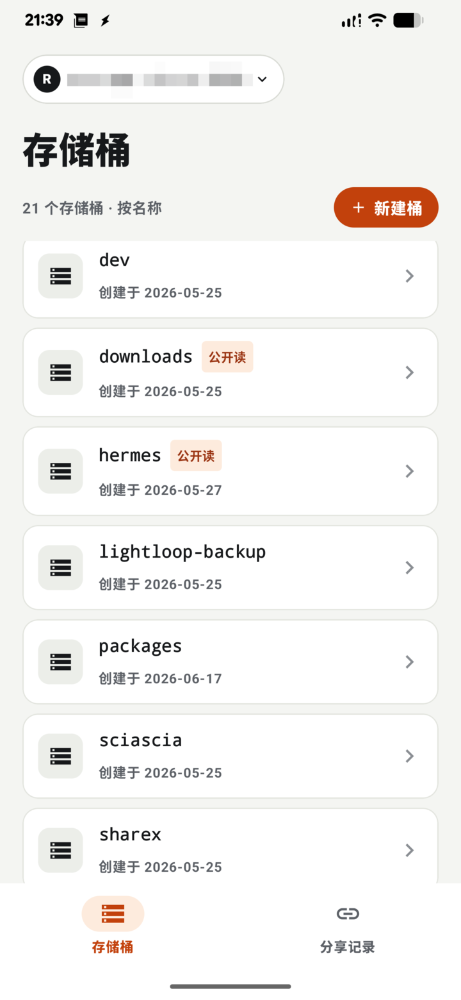
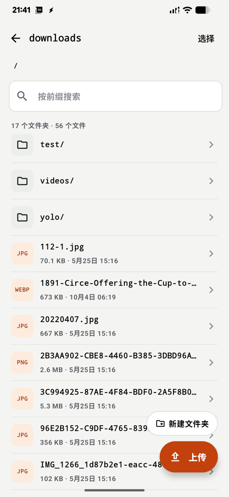
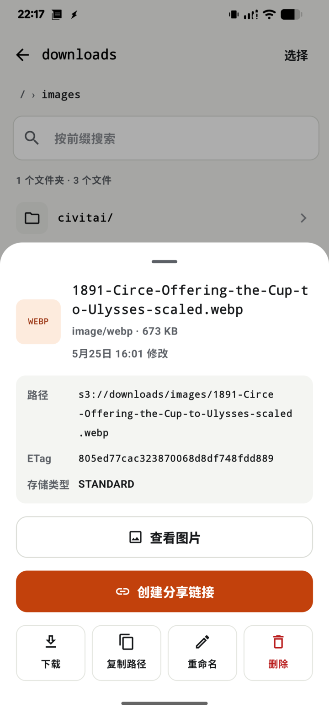
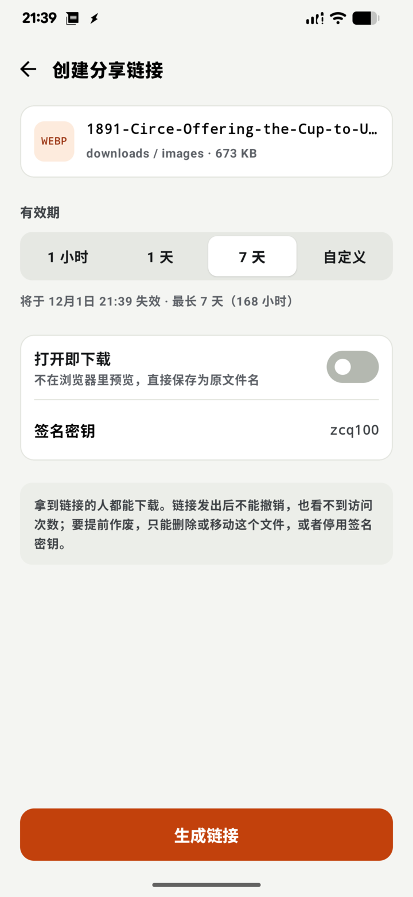
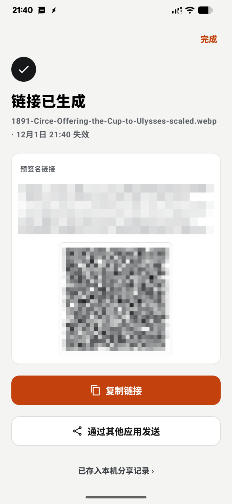

<h1 align="center">S3 Browser</h1>

<p align="center"><a href="README.md">简体中文</a> | English</p>

<p align="center">
  A native Android client for S3-compatible object storage<br>
  Browse, preview, upload and download, and share files with presigned links.
</p>

<p align="center">
  <a href="https://github.com/zcq100/s3-browser/releases/latest"></a>
  
  
  
  
  <a href="LICENSE"></a>
</p>

S3 Browser is a native Android app for managing S3-compatible object storage: browse buckets and objects, preview text and images, play videos in-app, upload and download files, and share a single object with a SigV4 presigned URL.

## Design principles

- **No backend.** The app talks directly to the object storage you configure; sharing an object means signing a URL. There is no service to run or pay for.
- **Only what the S3 API offers.** No trash, no cross-bucket moves, no server-side share history — nothing that would require an extra service.
- **Credentials stay on the device.** Secret keys are encrypted with a non-exportable AES key in the Android Keystore before being written to disk. No accounts, telemetry or cloud sync.

## Screenshots

| Buckets | Files | File actions |
|:---:|:---:|:---:|
|  |  |  |
| **Create share link** | **Link generated** | **Image viewer** |
|  |  |  |

> Presigned URLs and QR codes in the screenshots have been redacted.

## Features

| Area | Capabilities |
|---|---|
| **Connections** | Multiple connections; provider presets; path-style / virtual-hosted-style addressing; custom endpoint |
| **Browsing** | Folder hierarchy, prefix search, pagination; pull-to-refresh on the bucket list; public-read buckets are marked |
| **Transfer** | Multi-select upload and download; downloads are handed to DownloadManager and saved under Download/S3 |
| **File actions** | New folder, rename, delete, copy the `s3://` path |
| **Viewing** | Text (UTF-8 / UTF-16 / GB18030, binary detection), images (sampled decoding + pinch zoom), video (streaming playback with progress controls) |
| **Sharing** | Presigned links: 1 hour / 1 day / 7 days / custom; QR code; force-download; copy or send to another app |
| **Share history** | Stored only on the device; regenerate, copy or delete a record — deleting a record does not revoke the link |
| **Bucket management** | Create buckets; public-read, versioning and object lock (switches appear only for providers known to support them) |

## Supported services

All requests use the standard S3 API. Provider presets only set defaults and decide which bucket-level features are shown.

| Provider | Example endpoint | Default addressing | Notes |
|---|---|---|---|
| Amazon S3 | Leave empty; derived from the region | Virtual-hosted | |
| MinIO / self-hosted | `http://192.168.1.10:9000` | Path | |
| Alibaba Cloud OSS | `https://oss-cn-hangzhou.aliyuncs.com` | Virtual-hosted | Virtual-hosted addressing only |
| Tencent Cloud COS | `https://cos.ap-guangzhou.myqcloud.com` | Virtual-hosted | |
| Huawei Cloud OBS | `https://obs.cn-north-4.myhuaweicloud.com` | Virtual-hosted | |
| Qiniu Kodo | `https://s3.cn-east-1.qiniucs.com` | Virtual-hosted | |
| Cloudflare R2 | `https://<account-id>.r2.cloudflarestorage.com` | Path | Set the region to `auto` |
| Other S3-compatible | Custom | Path | Addressing can be switched manually |

## Getting started

### Install

Download the APK from [Releases](https://github.com/zcq100/s3-browser/releases/latest). Android 8.0 (API 26) or newer is required.

Or build and install it locally:

```bash
git clone https://github.com/zcq100/s3-browser.git
cd s3-browser
JAVA_HOME=/path/to/android-studio/jbr ./gradlew :app:assembleDebug
adb install -r app/build/outputs/apk/debug/app-debug.apk
```

### Add a connection

1. Open the app, tap the connection name at the top, then choose "Add connection" in the switch sheet.
2. Choose a provider and enter the endpoint, region, access key and secret key.
3. Pick the addressing style: path style for most MinIO setups; virtual-hosted style is required for Alibaba Cloud OSS.
4. Save. The bucket list will load; saved secret keys are never displayed again.

### Common tasks

- **View a file**: tap a file, then choose "View text", "View image" or "Play video". Audio and SVG files open in an installed app.
- **Share a file**: file sheet → "Create share link" → choose an expiry → copy the link or show its QR code.
- **Download**: "Download" in the file sheet, or select multiple files in selection mode.
- **Create a bucket**: "New bucket" at the top right of the bucket list; enable public-read, versioning or object lock as needed.

## How sharing works

A share link is a SigV4 presigned URL. Anyone with the link can download the object — no sign-in required, and the link cannot be revoked. Links expire after at most 7 days, and the app does not record downloads. To invalidate a link early, delete or move the object, or disable the signing key. Share history is stored on this device only and is lost when the app is uninstalled or its data is cleared.

## Compatibility with third-party S3 services

`AwsObjectStore` makes these adjustments for compatible services:

- Checksums are calculated only when the API requires them (`WHEN_REQUIRED`); no CRC32 is added by default.
- aws-chunked streaming uploads are disabled; uploads use Content-Length and a fully signed payload.
- Objects are deleted one at a time with `DeleteObject` instead of `DeleteObjects`, which requires Content-MD5 / checksum headers.
- Each connection can switch between path-style and virtual-hosted-style addressing.

## Build from source

**Requirements**: JDK 17+ (with `javac`) and the Android SDK (compileSdk 37). If only a JRE is installed, point `JAVA_HOME` at Android Studio's bundled JBR.

```bash
# Unit tests
./gradlew :app:testDebugUnitTest

# Debug APK
JAVA_HOME=/path/to/android-studio/jbr ./gradlew :app:assembleDebug
```

Release builds are signed with your own keystore, supplied through environment variables:

```bash
export RELEASE_KEYSTORE_FILE=/path/to/release.jks
export RELEASE_KEYSTORE_PASSWORD=...
export RELEASE_KEY_ALIAS=...
export RELEASE_KEY_PASSWORD=...

./gradlew :app:assembleRelease -PversionName=1.0.0 -PversionCode=10000
```

## Project layout

```
app/src/main/java/com/zcq100/s3browser/
├── s3/            ObjectStore interface, AWS SDK implementation, error mapping
├── data/          Connections (encrypted via Keystore), provider presets, local share history
└── ui/
    ├── buckets/    Bucket list, new bucket
    ├── files/      File browser, selection mode, action sheet
    ├── preview/    Text, image and video viewers
    ├── share/      Share link creation, QR code, share history
    ├── connection/ Add and edit connections
    ├── common/     Shared components and formatting
    └── theme/      Palette and theme
design/            UI design files
docs/screenshots/  README screenshots
```

## Tech stack

| Area | Technology |
|---|---|
| Language & UI | Kotlin 2.4, Jetpack Compose, Material 3, Navigation Compose |
| Object storage | AWS SDK for Kotlin (`aws.sdk.kotlin:s3`) |
| Local storage | DataStore Preferences, kotlinx.serialization |
| Secret protection | Android Keystore (AES/GCM) |
| QR codes | ZXing Core |
| Build | Gradle 9.8, AGP 9.5, JDK 17, compileSdk 37 |
| Minimum version | Android 8.0 (API 26) |

## Security and privacy

- Secret keys exist in plain text only in memory and are encrypted with the Android Keystore before being persisted. `allowBackup=false` keeps them out of cloud backups.
- There is no account system or first-party server. The app sends no data anywhere except the object storage endpoint you configure, and it contains no analytics or crash reporting.
- A share link is itself a credential; be careful when forwarding it or taking screenshots.
- Downloads are handled by the system DownloadManager, so the app process does not write the file.

## Known limitations

- Presigned links last at most 7 days and cannot be revoked or limited to a number of downloads.
- There is no object-version browsing, ACL / bucket-policy editing or cross-bucket move; rename is Copy + Delete.
- Text preview reads the first 512 KB only; images larger than 32 MB are rejected with a download hint.
- Video playback depends on the device decoders; unsupported codecs show a download hint instead.
- Uploads run inside the app and require it to stay in the foreground.
- Bucket-level features appear only for providers known to support them — better to hide a switch than to fail after the user sets it.

## Contributing

Issues and pull requests are welcome.

- When reporting a compatibility problem, include the provider, the addressing style (path / virtual-hosted) and any error code or response body.
- Adding a provider: extend the preset and feature set in `data/Provider.kt`, and check its default addressing style.
- Run `./gradlew :app:testDebugUnitTest :app:assembleDebug` before submitting, and reuse the existing `Palette` and shared components in the UI.
- Put new storage operations on the `ObjectStore` interface instead of depending on the AWS SDK from the UI layer.

## License

Copyright 2026 zcq100. Released under the [Apache License 2.0](LICENSE).

## Acknowledgements

- [AWS SDK for Kotlin](https://github.com/awslabs/aws-sdk-kotlin)
- [Jetpack Compose](https://developer.android.com/jetpack/compose)
- [ZXing](https://github.com/zxing/zxing)
- [AndroidX](https://developer.android.com/jetpack/androidx)
