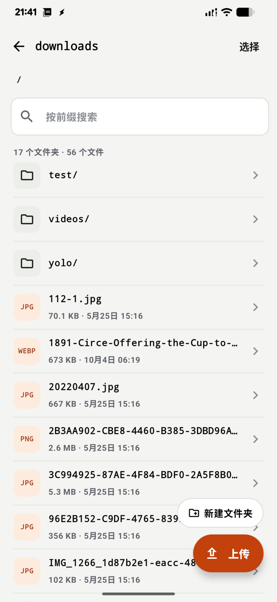

<h1 align="center">S3 浏览器</h1>

<p align="center">
  Android 上的 S3 兼容对象存储客户端<br>
  浏览、预览、上传下载，用预签名链接分享文件。
</p>

<p align="center">
  <a href="https://github.com/zcq100/s3-browser/releases/latest"></a>
  
  
  
  
</p>

S3 浏览器是一个原生 Android 应用，用来管理 S3 兼容对象存储：浏览存储桶和文件、查看文本/图片、内置播放视频、上传下载，以及用 SigV4 预签名链接分享单个文件。

## 设计原则

- **没有后端。** 应用不依赖任何自建服务，请求直接发往你配置的对象存储；分享就是把对象签成一条 URL。
- **只做 S3 API 能做的事。** 没有回收站、跨桶移动、服务端分享记录这类需要额外服务的功能。
- **凭证不出设备。** Secret Key 用 Android Keystore 中不可导出的 AES 密钥加密后才落盘，没有账号、遥测或云端同步。

## 截图

| 存储桶 | 浏览文件 | 文件操作 |
|:---:|:---:|:---:|
|  |  |  |
| **创建分享链接** | **链接已生成** | **查看图片** |
|  |  |  |

> 截图中的预签名链接与二维码已打码。

## 功能

| 模块 | 能力 |
|---|---|
| **连接** | 多连接切换；服务商预设；路径风格 / 虚拟主机风格寻址；可选的自定义 Endpoint |
| **浏览** | 目录层级、前缀搜索、分页加载；桶列表支持下拉刷新，公开读的桶会标记出来 |
| **上传下载** | 多选上传与下载；下载交给系统 DownloadManager，保存到「下载/S3」 |
| **文件操作** | 新建文件夹、重命名、删除、复制 `s3://` 路径 |
| **查看** | 文本（UTF-8 / UTF-16 / GB18030，自动识别二进制）、图片（采样解码 + 双指缩放）、视频（流式播放，带进度控制） |
| **分享** | 预签名链接：1 小时 / 1 天 / 7 天 / 自定义；二维码；打开即下载；复制或通过其他应用发送 |
| **分享记录** | 只保存在本机；可重新生成、复制、删除，删除记录不影响已发出的链接 |
| **桶管理** | 新建桶；公开读、版本控制、对象锁定（按服务商能力显示对应开关） |

## 支持的服务

请求全部走标准 S3 API。服务商预设只决定默认值和界面上显示哪些桶级功能。

| 服务商 | Endpoint 示例 | 默认寻址 | 备注 |
|---|---|---|---|
| Amazon S3 | 留空，按区域自动生成 | 虚拟主机 | |
| MinIO / 自建 | `http://192.168.1.10:9000` | 路径 | |
| 阿里云 OSS | `https://oss-cn-hangzhou.aliyuncs.com` | 虚拟主机 | 只接受虚拟主机风格 |
| 腾讯云 COS | `https://cos.ap-guangzhou.myqcloud.com` | 虚拟主机 | |
| 华为云 OBS | `https://obs.cn-north-4.myhuaweicloud.com` | 虚拟主机 | |
| 七牛云 Kodo | `https://s3.cn-east-1.qiniucs.com` | 虚拟主机 | |
| Cloudflare R2 | `https://<账户ID>.r2.cloudflarestorage.com` | 路径 | 区域填 `auto` |
| 其他 S3 兼容 | 自定义 | 路径 | 可手动切换寻址方式 |

## 快速开始

### 安装

从 [Releases](https://github.com/zcq100/s3-browser/releases/latest) 下载 APK。要求 Android 8.0（API 26）及以上。

也可以本地构建后安装：

```bash
git clone https://github.com/zcq100/s3-browser.git
cd s3-browser
JAVA_HOME=/path/to/android-studio/jbr ./gradlew :app:assembleDebug
adb install -r app/build/outputs/apk/debug/app-debug.apk
```

### 添加连接

1. 打开应用，点击顶部的连接名称，在「切换连接」面板里选择「添加连接」。
2. 选择服务商，填写 Endpoint、区域、Access Key 和 Secret Key。
3. 按服务商选择寻址方式：MinIO 一般用路径风格，阿里云 OSS 必须用虚拟主机风格。
4. 保存后即可看到桶列表；已保存的 Secret Key 不会在界面上回显。

### 常用操作

- **查看文件**：点文件打开详情面板，选择「查看文本 / 查看图片 / 播放视频」。音频和 SVG 交给系统里已安装的应用。
- **分享文件**：详情面板 →「创建分享链接」→ 选择有效期 → 生成后可复制链接或展示二维码。
- **下载**：面板里的「下载」，或在「选择」模式下多选后下载。
- **新建桶**：桶列表右上角「新建桶」，按需开启公开读、版本控制或对象锁定。

## 分享链接的工作方式

分享链接是 SigV4 预签名 URL，拿到链接的人都能直接下载，**不需要登录，也无法撤销**。签名有效期最长 7 天，应用不记录访问次数；要提前作废，只能删除或移动对象，或者停用对应的签名密钥。分享记录只保存在本机，卸载应用或清除数据后不会保留。

## 与第三方 S3 服务的兼容性

`AwsObjectStore` 针对兼容服务做了这些调整：

- 只在 API 强制要求时计算校验和（`WHEN_REQUIRED`），不默认附加 CRC32；
- 关闭 aws-chunked 流式上传，用 Content-Length + 完整签名上传；
- 删除时逐个调用 `DeleteObject`，不用强制要求 Content-MD5 / 校验和头的 `DeleteObjects`；
- 每个连接可切换路径风格 / 虚拟主机风格寻址。

## 从源码构建

**要求**：JDK 17+（包含 `javac`）、Android SDK（compileSdk 37）。如果系统只有 JRE，可以使用 Android Studio 自带的 JBR。

```bash
# 单元测试
./gradlew :app:testDebugUnitTest

# 调试包
JAVA_HOME=/path/to/android-studio/jbr ./gradlew :app:assembleDebug
```

正式包使用自己的 keystore 签名，通过环境变量传入：

```bash
export RELEASE_KEYSTORE_FILE=/path/to/release.jks
export RELEASE_KEYSTORE_PASSWORD=...
export RELEASE_KEY_ALIAS=...
export RELEASE_KEY_PASSWORD=...

./gradlew :app:assembleRelease -PversionName=1.0.0 -PversionCode=10000
```

## 项目结构

```
app/src/main/java/com/zcq100/s3browser/
├── s3/            ObjectStore 接口、AWS SDK 实现、错误映射
├── data/          连接配置（Keystore 加密）、服务商预设、本机分享记录
└── ui/
    ├── buckets/    桶列表、新建桶
    ├── files/      文件浏览、选择模式、操作面板
    ├── preview/    文本、图片、视频查看
    ├── share/      创建分享链接、二维码、分享记录
    ├── connection/ 添加与编辑连接
    ├── common/     通用组件与格式化
    └── theme/      色板与主题
design/            UI 设计稿
docs/screenshots/  README 截图
```

## 技术栈

| 类别 | 使用 |
|---|---|
| 语言与 UI | Kotlin 2.4、Jetpack Compose、Material 3、Navigation Compose |
| 对象存储 | AWS SDK for Kotlin（`aws.sdk.kotlin:s3`） |
| 本地存储 | DataStore Preferences、kotlinx.serialization |
| 密钥保护 | Android Keystore（AES/GCM） |
| 二维码 | ZXing Core |
| 构建 | Gradle 9.8、AGP 9.5、JDK 17、compileSdk 37 |
| 最低版本 | Android 8.0（API 26） |

## 安全与隐私

- Secret Key 只在内存中明文存在，落盘前用 Android Keystore 加密；`allowBackup=false`，不会被系统备份到云端。
- 应用没有自有账号体系和服务器，除配置的对象存储 Endpoint 外不发送任何数据，也没有统计或崩溃上报。
- 分享链接本身就是访问凭证，转发或截图时注意范围。
- 下载请求交给系统 DownloadManager，应用进程不参与文件落盘。

## 已知限制

- 预签名链接最长 7 天，不能撤销、不能限制下载次数。
- 不提供对象版本浏览、ACL / 桶策略编辑、跨桶移动；重命名是 Copy + Delete。
- 文本预览只读取前 512 KB，图片超过 32 MB 会提示下载后查看。
- 视频播放依赖系统解码器；编码不受支持时会提示下载后用本机播放器打开。
- 上传在应用内进行，过程中请保持应用在前台。
- 第三方服务只有确认支持的功能才会出现在新建桶界面，宁可少显示一个开关，也不让用户点了才报错。

## 贡献

欢迎提交 Issue 和 Pull Request。

- 报告兼容性问题时，请附上服务商、Endpoint 风格（路径 / 虚拟主机）以及错误码或响应体。
- 新增服务商：在 `data/Provider.kt` 里补充预设和功能集合，注意默认寻址方式。
- 提交前请运行 `./gradlew :app:testDebugUnitTest :app:assembleDebug`，并保持 UI 使用现有的 `Palette` 与公共组件。
- 新的存储操作请加在 `ObjectStore` 接口上，不要在 UI 层直接依赖 AWS SDK。

## 许可证

仓库目前没有 `LICENSE` 文件；在补充许可证之前，代码保留所有权利。

## 致谢

- [AWS SDK for Kotlin](https://github.com/awslabs/aws-sdk-kotlin)
- [Jetpack Compose](https://developer.android.com/jetpack/compose)
- [ZXing](https://github.com/zxing/zxing)
- [AndroidX](https://developer.android.com/jetpack/androidx)
