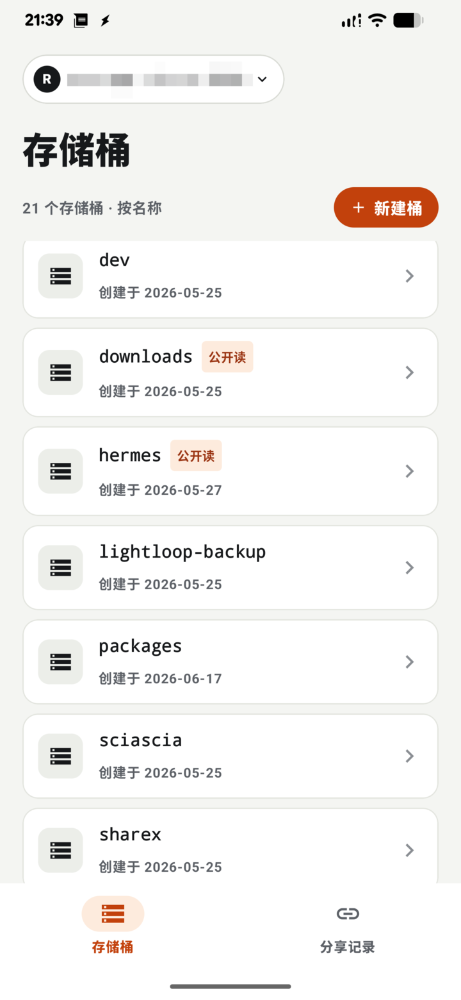
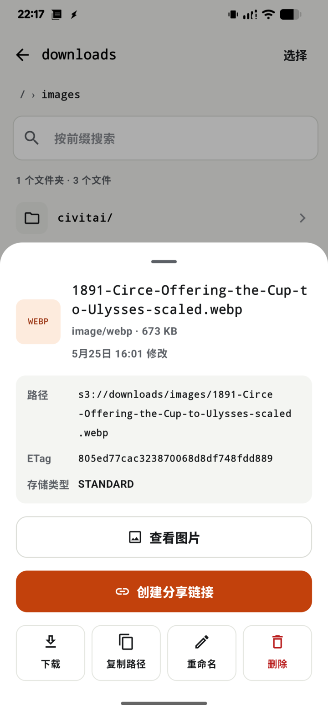
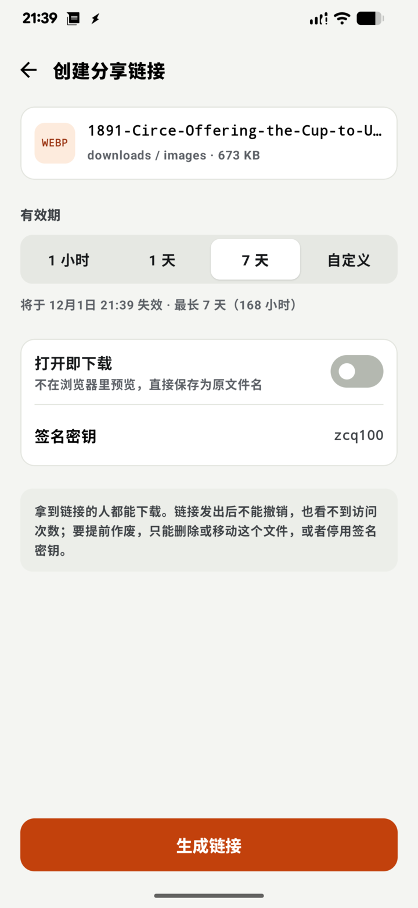
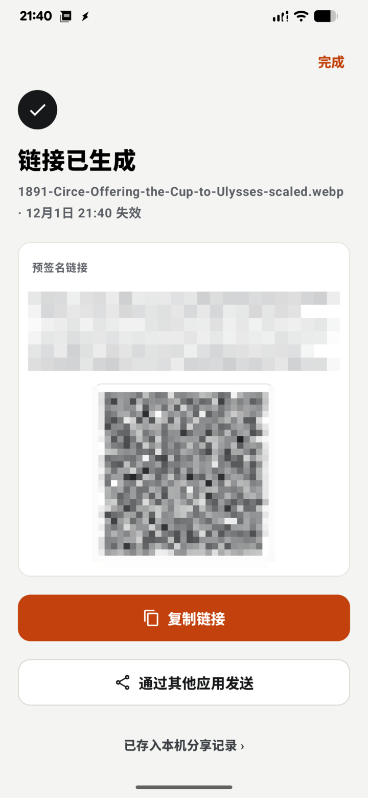
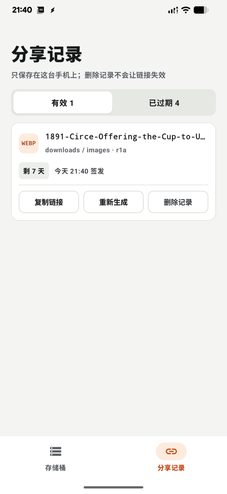

# S3 浏览器（Android）

手机上管理 S3 兼容对象存储：浏览存储桶和文件、查看文本和图片、播放视频、上传下载、创建预签名分享链接、新建存储桶。音频、SVG 用预签名链接交给系统里已安装的其他应用打开。

除了对象存储本身没有任何后端；对象存储 API 不支持的功能不做。分享就是 SigV4 预签名链接（最长 7 天、不能撤销、没有访问统计），分享记录只存在本机。

支持 AWS S3、MinIO、阿里云 OSS、腾讯云 COS、华为云 OBS、七牛 Kodo、Cloudflare R2 及其他 S3 兼容服务。

## 截图

| 存储桶 | 浏览文件 | 文件操作 |
|:---:|:---:|:---:|
|  |  |  |
| **创建分享链接** | **链接已生成** | **本机分享记录** |
|  |  |  |

> 截图中的预签名链接与二维码已打码。

## 构建

需要 JDK 17+（带 `javac`）和 Android SDK（compileSdk 37）。系统只有 JRE 时可用 Android Studio 自带的 JBR：

```bash
JAVA_HOME=/opt/android-studio/jbr ./gradlew :app:assembleDebug
adb install -r app/build/outputs/apk/debug/app-debug.apk
```

## 结构

- `app/src/main/java/com/zcq100/s3browser/s3/` — `ObjectStore` 接口及基于 AWS SDK for Kotlin 的实现
- `.../data/` — 连接配置（Secret Key 经 Android Keystore 加密）、服务商预设、本机分享记录
- `.../ui/` — Jetpack Compose 界面
- `.../ui/preview/` — 文本、图片、视频的内置查看；音频和 SVG 签临时链接交给外部应用
- `design/` — 设计稿源文件

## 兼容性配置

`AwsObjectStore` 为第三方 S3 服务做了这些调整：

- 只在 API 强制要求时计算校验和（`WHEN_REQUIRED`），不默认附加 CRC32；
- 关闭 aws-chunked 流式上传，用 Content-Length + 完整签名上传；
- 删除逐个调用 DeleteObject，不用要求 Content-MD5/校验和头的 DeleteObjects；
- 每个连接可切换路径风格 / 虚拟主机风格寻址（阿里云 OSS 只接受虚拟主机风格）。
